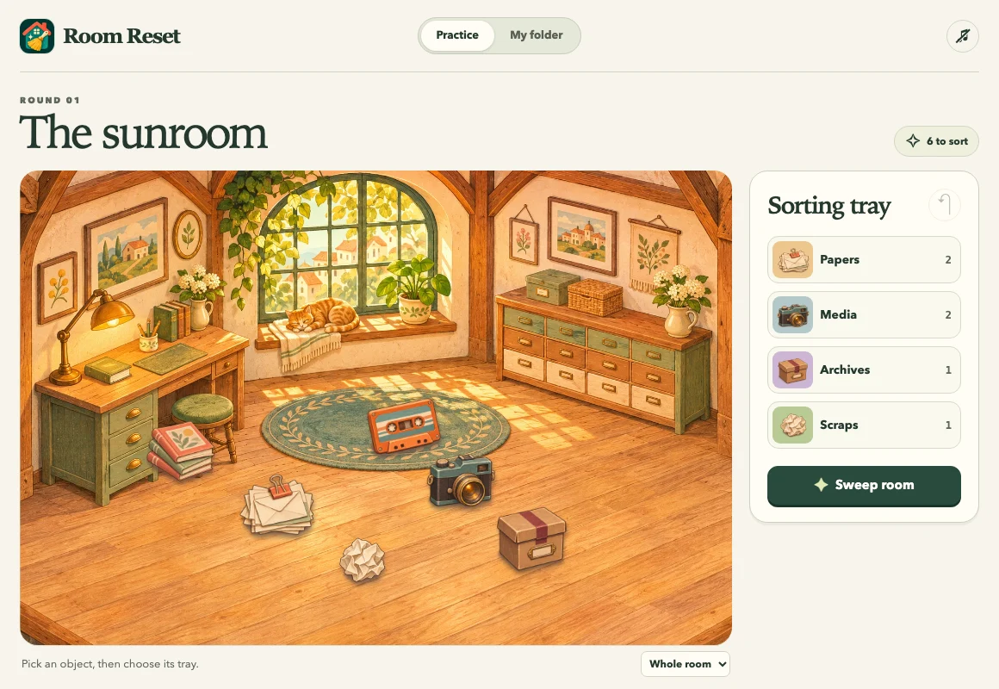

# Room Reset

A little room to tidy on macOS, iOS and Android. Drag the camera, books and loose papers off the floor and into their trays. Finish the sunroom to play by moonlight.

[Download Room Reset for macOS, iOS, or Android](https://github.com/techpool/room-reset/releases/latest)



## Play

Start in **Practice**. Drag an object to its tray, or tap the object and then the tray. Select a tray to sweep one category. Use the area selector to work on one part of the room. **Sweep room** tidies the rest. Undo returns the last batch to the floor. Practice saves your round on this device.

Choose **My folder** to use real files. Pick a folder of loose downloads or documents, then tap an object or use **View files** to see its name. Every tidy action shows the files it will move. Whole-room sweeps use the same preview. The game runs offline, including its artwork and sounds.

## What happens to files

* A scan looks at the immediate files in the folder you picked. The Papers, Media and Archives trays move supported files into organizer folders inside it. These moves change where you find a file and use no compression.
* The Scraps tray stages eligible files. A download copy such as `notes (1).pdf` needs a matching original and identical contents. Mongo export copies are also compared by contents. The keeper stays in place. The game operates on exported files and has no database connection.
* **Undo** uses a local history to move a batch back. **Empty staging** is a separate, permanent action. The app checks a staged duplicate and its keeper again before removing it. On Apple platforms, a resource fork, Finder tag or unrecognized extended attribute also protects a copy from disposal. Staged byte counts describe files, and filesystem sharing can affect the space actually reclaimed.
* On macOS you can also choose the default Homebrew downloads cache to stage old, completed bottles. The Apple build recognizes Finder metadata files. See the platform source for eligibility checks.

Folder access uses the system picker. Android requires a writable documents provider with move support. A subfolder of Downloads works on devices whose picker restricts selection of the Downloads root. [Android folder-access documentation](https://developer.android.com/training/data-storage/shared/documents-files) · [Apple directory-access documentation](https://developer.apple.com/documentation/uikit/providing-access-to-directories)

## Run on a Mac, iPhone or iPad

Open `apple/RoomReset.xcodeproj` in Xcode. Choose **RoomResetMac** and **My Mac**, or **RoomResetIOS** and an iPhone or iPad simulator, then Run. For a physical iPhone or iPad, select your own development team in Signing & Capabilities, use a bundle identifier registered to that team, select the connected device and Run. The minimum versions are macOS 14 and iOS 17.

From the project root, use Xcode's command-line tools to build and run the Mac app.

```sh
xcodebuild -project apple/RoomReset.xcodeproj -scheme RoomResetMac \
  -configuration Release -derivedDataPath build/apple build
open "build/apple/Build/Products/Release/Room Reset.app"
```

## Run on Android

Open `android/` in Android Studio or use its Gradle wrapper with JDK 17 or 21 and Android SDK Platform 35. Enable USB debugging on a development device or start an emulator. The app requires Android 8.0 (API 26) or newer and an up-to-date Android System WebView.

```sh
cd android
./gradlew :app:assembleDebug
adb install -r app/build/outputs/apk/debug/app-debug.apk
```

## Develop and test

`web/` contains the shared game, local artwork and interactions. Open `web/index.html` directly in a recent browser to play Practice. The native Swift and Java hosts provide the folder picker, move journal, file checks and staging operations.

```sh
node --test tests/practice.test.cjs
node tests/browser-smoke.mjs
apple/Tools/test-folders.sh
(cd android && ./gradlew :app:connectedDebugAndroidTest)
```

Browser interaction tests use Node 22+ and a local Chromium browser. Set `CHROME` to its executable path when needed. Run Apple tests on a Mac with Xcode, and Android instrumented tests with a booted emulator.

For an end-to-end iPhone test, run `apple/Tools/test-ios-picker.sh <simulator-uuid>` with a booted English-language iPhone simulator. It creates a disposable folder, sorts it through the system Files picker, undoes the move and verifies the restored contents. The Android test setup is documented in [android/README.md](android/README.md).

## License and artwork

Room Reset's source and original artwork are distributed under the [MIT License](LICENSE). The [artwork notes](docs/artwork.md) include the ChatGPT image generation prompts. The Android build includes the Gradle wrapper, distributed under the terms in [third-party/gradle](third-party/gradle/).
